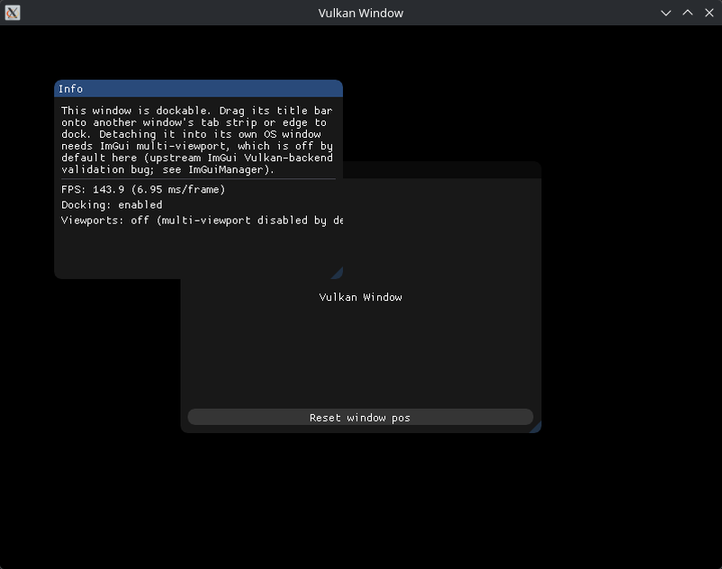

<div align="center">

  <h1>VulkanWindow</h1>

  <a href="https://github.com/gage-lodba/VulkanWindow/actions/workflows/build.yml">
    
  </a>

</div>

A minimalistic C++20 scaffold for building Vulkan + Dear ImGui + GLFW
applications. Provides a windowed Vulkan renderer with depth, swap-chain
recreation, persistent pipeline cache, and an ImGui frame loop — so apps can
focus on their own geometry and UI.

> **Upgrading to 0.4.1:** this release fixes the swap-chain-rebuild crash in
> 0.4.0 (a rebuilt ImGui manager's backends were never initialised, so calling
> `setPresentMode()` after startup could assert in Debug and segfault in
> Release) and makes several documented behaviours precise:
>
> - `SwapchainRecreateInfo` gained `imguiContextRebuilt`. It is `true` whenever
>   the ImGui context and backends were torn down and rebuilt. Besides
>   surface-format changes, image-count and min-image-count changes (for example
>   a runtime `Mailbox` present-mode switch) also recreate the context, so this
>   flag can be true while `formatChanged` is false. The callback still fires
>   **after** the new backends are initialised; re-register any
>   `ImGui_ImplVulkan_AddTexture` handles when it is `true` (see
>   "Application API").
> - Parent-provided Dear ImGui must now be **≥ 1.92.8**: the renderer uses
>   `IMGUI_IMPL_VULKAN_MINIMUM_SAMPLED_IMAGE_POOL_SIZE`, introduced in that
>   release. The bundled submodule (1.92.9b, docking branch) is unaffected.
> - Font callbacks are applied once per ImGui context; previously they ran twice
>   before the first frame, duplicating atlas entries. ImGui backend `VkResult`
>   failures are logged to stderr instead of being ignored.
> - `VULKANWINDOW_MAX_FRAMES` and `VULKANWINDOW_DEVICE_INDEX` are parsed
>   all-or-nothing: malformed values (trailing garbage, negative) are treated as
>   unset instead of partially parsed — unlimited frames and auto device scoring
>   respectively.
> - Utility hardening changes observable behaviour:
>   - `vkutil::vkResultString()` now maps every distinct `VkResult` value in the
>     Vulkan headers the library was built against (canonical names; aliases
>     share values). `VK_RESULT_<unknown>` remains only for codes newer than
>     those headers.
>   - `createShaderModule` throws `std::invalid_argument` for a null pointer,
>     `sizeBytes == 0`, or `sizeBytes % 4 != 0`.
>   - `createMappedBuffer`, `createDeviceLocalBuffer` and `createTexture2D`
>     reject zero sizes/dimensions and null pointers with
>     `std::invalid_argument` before touching Vulkan/VMA.
>   - `transitionImageLayout` throws `std::invalid_argument` for
>     `mipLevels == 0` or `aspectMask == 0`.
>   - `createDescriptorPool` throws `std::invalid_argument` for `maxSets == 0`.
>   - Mipmapped `createTexture2D` requires
>     `SAMPLED_IMAGE_FILTER_LINEAR | BLIT_SRC | BLIT_DST` on the format
>     (`std::runtime_error` otherwise), and staged-upload flush failures throw
>     `std::runtime_error`.
>   - `isSrgbFormat()` covers seven eight-bit formats, adding
>     `VK_FORMAT_R8_SRGB` and `VK_FORMAT_R8G8_SRGB`.
>   - `PipelineCacheStore` performs a real file flush on Windows (save fails if
>     the sync fails), and the no-per-user-cache-directory fallback keeps the
>     app-name namespace and sweeps stale temp files there; the cache path can
>     therefore change once on fallback setups.
>
> **Upgrading from 0.3.x:** `SwapchainRecreateInfo` lives in
> `SwapchainRecreateInfo.h` instead of `VulkanRenderer.h` (0.4.0 split it out of
> the renderer header). Consumer code that included the renderer header to name
> the type from `setSwapchainRecreatedCallback` should include the new header,
> which no longer pulls in GLFW. Beyond the additions listed above there are no
> further public-surface changes; note that `SwapchainRecreateInfo` is an
> aggregate, so code that constructs it positionally (rather than receiving it
> from the callback) must be recompiled and account for the new
> `imguiContextRebuilt` field.
>
> **Version history:** release tags through `v0.3.0` all shipped with
> `PROJECT_VERSION` still at 0.1.0, so `find_package(VulkanWindow <version>)` did
> not gate on the version you would expect. It has read the release version
> since 0.4.0, and the release job now refuses to publish a `v*` tag whose
> version disagrees with `PROJECT_VERSION`.

<div align="center">
  
</div>

## Quick start

```cpp
#include "Application.h"
#include "UserInterface.h"

int main() {
    Application app;

    UserInterface ui;
    app.setUICallback([&ui] { ui.render(); });

    // Optional: draw your own Vulkan geometry between BeginRenderPass and
    // ImGui (ImGui composites on top).
    app.setRenderCallback([](VkCommandBuffer cmd, VkExtent2D extent) {
        // vkCmdBindPipeline / vkCmdDraw / etc. here.
    });

    app.run();
}
```

`UserInterface.h` is the library's own stateless demo UI (`source/UserInterface.h`)
— it installs the demo dock space plus its main and info windows, the same UI the
`VulkanWindowDemo` binary shows. Drop it and pass your own `setUICallback` to
start from a bare window.

## Building from source

### Dependencies

- [CMake](https://cmake.org/) ≥ 3.18 (3.20+ if you want to run the tests with
  `ctest --test-dir build`; on 3.18/3.19 use `cd build && ctest`)
- [Vulkan SDK](https://www.vulkan.org/) (or system Vulkan headers + loader)
- A C++20 compiler (GCC 10+, Clang 12+, MSVC 19.30+). On macOS use a recent
  toolchain (Clang 14+ recommended): the library uses C++20 designated
  initializers and `std::ranges`, which older libc++ releases lack.

GLFW, Dear ImGui, and VulkanMemoryAllocator are vendored as git submodules
under `deps/`.

### Build

```bash
git submodule update --init --recursive
cmake -B build -DCMAKE_BUILD_TYPE=Release
cmake --build build --config Release

./build/VulkanWindow            # Linux
./build/Release/VulkanWindow.exe  # Windows / MSVC
```

### CMake options

| Option | Default | Description |
| --- | --- | --- |
| `VULKANWINDOW_BUILD_DEMO` | `ON` if top-level, else `OFF` | Build the `VulkanWindowDemo` executable. |
| `VULKANWINDOW_BUILD_EXAMPLES` | `ON` if top-level, else `OFF` | Build the example executables under `examples/`. Needs `glslc` (Vulkan SDK); skipped with a message if absent. |
| `VULKANWINDOW_BEST_PRACTICES` | `OFF` | In Debug builds, enable `VK_VALIDATION_FEATURE_ENABLE_BEST_PRACTICES_EXT`. CI runs a filtered best-practices gate with this on; see "Validation and best practices". |
| `VULKANWINDOW_BUILD_TESTS` | `OFF` | Build the unit tests (`tests/`) plus the `VulkanWindowSwapchainRecreation` smoke binary CI runs (it needs a display, so it is not registered with ctest). Fetches doctest via `FetchContent`; needs CMake ≥ 3.18 (for `SOURCE_SUBDIR`) and network access at configure. Run with `ctest --test-dir build` (CMake ≥ 3.20) or `cd build && ctest`. |
| `VULKANWINDOW_WARNINGS_AS_ERRORS` | `OFF` | Treat the project's own strict warning set as errors: `-Werror` with GCC/Clang, `/WX` with MSVC. Only applies to targets this project defines (never inherited by consumers); CI enables it. See "Validation and best practices". |
| `VULKANWINDOW_INSTALL` | `OFF` | Emit install/export rules so consumers can `find_package(VulkanWindow)`. Requires `find_package(glfw3 CONFIG)` and `find_package(VulkanMemoryAllocator CONFIG)`; GLFW/VMA come from those packages instead of the vendored submodules, but the bundled Dear ImGui is still built from `deps/ImGui` and installed with the package. A parent-supplied `imgui` target is rejected at configure time (it cannot be exported); see "Using as a library". |

## Examples

Two self-contained, copy-pasteable references under `examples/` (built when
`glslc` is available; skipped without failing the build otherwise):

- **`triangle/`** — the minimal "bring your own geometry" path: a `VkPipeline`
  from GLSL (compiled to SPIR-V by `glslc` and embedded into the binary), a
  vertex-buffer-free coloured triangle drawn through `setRenderCallback` with
  ImGui composited on top, dynamic viewport+scissor, and a pipeline rebuilt only
  on a surface-format change via `setSwapchainRecreatedCallback`.
- **`textured_quad/`** — the full helper surface end-to-end: a vertex buffer
  (`createDeviceLocalBuffer`), a mipmapped texture + sampler (`createTexture2D` /
  `createSampler`), a descriptor set (`createDescriptorSetLayout` /
  `createDescriptorPool` / `allocateDescriptorSet` /
  `updateImageSamplerDescriptor`), and a pipeline with vertex input + the
  descriptor layout — built entirely against the `getContext()` / `getSwapchain()`
  handles.

```bash
cmake -B build -DCMAKE_BUILD_TYPE=Release
cmake --build build --config Release
./build/examples/triangle/VulkanWindowTriangle            # Linux / macOS
./build/examples/textured_quad/VulkanWindowTexturedQuad
# Windows (multi-config generators put each target under its config directory):
./build/examples/triangle/Release/VulkanWindowTriangle.exe
./build/examples/textured_quad/Release/VulkanWindowTexturedQuad.exe
```

### Compiling your own shaders

Linking VulkanWindow (via `add_subdirectory`/`FetchContent`, or
`find_package`) also gives you a CMake helper, `vulkanwindow_add_shaders`, that
compiles GLSL to SPIR-V (`glslc`) and embeds it as a C initializer list your
C++ can `#include` — no runtime shader files to ship:

```cmake
add_executable(my_app main.cpp)
vulkanwindow_add_shaders(my_app
  ${CMAKE_CURRENT_SOURCE_DIR}/shader.vert
  ${CMAKE_CURRENT_SOURCE_DIR}/shader.frag)
target_link_libraries(my_app PRIVATE VulkanWindow::VulkanWindow)
```

```cpp
constexpr uint32_t kVertSpv[] =
#include "shader.vert.spv.inc"
    ;
// ... pass kVertSpv / sizeof(kVertSpv) to VkShaderModuleCreateInfo.
```

The stage is inferred from each file's extension. `VULKANWINDOW_GLSLC_FOUND`
tells you whether `glslc` was located (guard the call with it if shaders are
optional); override discovery with `-DVULKANWINDOW_GLSLC=/path/to/glslc`. The
triangle example uses this exact helper.

### Resource helpers

`#include "VulkanResources.h"` for `vkutil::` helpers that cover the buffer
boilerplate every non-trivial renderer reimplements — built on the handles from
`getContext()`:

```cpp
#include "VulkanResources.h"
const VulkanContext &ctx = app.getContext();

// Device-local buffer, uploaded via an internal staging buffer + one-shot copy.
vkutil::Buffer vbuf = vkutil::createDeviceLocalBuffer(
    ctx.allocator, ctx.device, ctx.graphicsQueue, ctx.graphicsQueueFamily,
    vertices.data(), vertices.size() * sizeof(Vertex),
    VK_BUFFER_USAGE_VERTEX_BUFFER_BIT);

// Host-visible, persistently-mapped buffer for CPU-written data (uniforms,
// dynamic vertices). Write through `.mapped`, then flush so the GPU sees it.
vkutil::Buffer ubuf = vkutil::createMappedBuffer(
    ctx.allocator, sizeof(Ubo), VK_BUFFER_USAGE_UNIFORM_BUFFER_BIT);
std::memcpy(ubuf.mapped, &ubo, sizeof(ubo));
vkutil::flushMapped(ctx.allocator, ubuf);  // before the submit that reads it

// ... use vbuf.buffer / ubuf.buffer in your draws ...

vkutil::destroyBuffer(ctx.allocator, vbuf);
vkutil::destroyBuffer(ctx.allocator, ubuf);
```

Also provides `beginSingleTimeCommands` / `endSingleTimeCommands` for your own
one-shot GPU work (copies, layout transitions). `createDeviceLocalBuffer`
blocks until the upload completes, so it's for load-time uploads, not the
per-frame hot path — for per-frame data use a mapped buffer (one per
`getFramesInFlight()` slot) and write it from `getCurrentFrameIndex()`. Call
`flushMapped` after each frame's writes, before submitting: it's a cheap no-op
on the coherent memory most discrete GPUs hand out, but it's required for the
mapped buffer to be correct on hardware that isn't coherent, so don't skip it.

Textures come with the same one-call treatment — staged upload, layout
transitions, optional mipmaps, and a view, all handled for you:

```cpp
// pixels: width*height RGBA8 texels (e.g. from stb_image). Use a *_UNORM
// format to show the texels verbatim on the default Unorm swap-chain; use a
// *_SRGB format only if the texture feeds linear-space lighting (and an Srgb
// swap-chain) — see "Surface format and ImGui colours".
vkutil::Image tex = vkutil::createTexture2D(
    ctx.allocator, ctx.physicalDevice, ctx.device, ctx.graphicsQueue,
    ctx.graphicsQueueFamily, pixels, width * height * 4, width, height,
    VK_FORMAT_R8G8B8A8_UNORM, /*generateMipmaps=*/true);
VkSampler sampler = vkutil::createSampler(ctx.device);

// tex.view + sampler go into a combined-image-sampler descriptor...

vkutil::destroyImage(ctx.allocator, ctx.device, tex);
vkDestroySampler(ctx.device, sampler, nullptr);
```

`transitionImageLayout` is exposed for your own images (it rejects
`mipLevels == 0`). Mipmap generation requires the format to support linear
filtering **and** both blit source and destination usage on optimal tiling
(`SAMPLED_IMAGE_FILTER_LINEAR` + `BLIT_SRC`/`BLIT_DST`); it throws otherwise.
`createSampler` leaves anisotropy off since that device feature isn't enabled by
the scaffold.

`#include "VulkanDescriptors.h"` for the descriptor-set boilerplate — layout,
pool, allocation, and writes:

```cpp
VkDescriptorSetLayout layout = vkutil::createDescriptorSetLayout(
    ctx.device, {{0, VK_DESCRIPTOR_TYPE_COMBINED_IMAGE_SAMPLER,
                  VK_SHADER_STAGE_FRAGMENT_BIT}});
VkDescriptorPool pool = vkutil::createDescriptorPool(
    ctx.device, {{VK_DESCRIPTOR_TYPE_COMBINED_IMAGE_SAMPLER, 1}}, /*maxSets=*/1);
VkDescriptorSet set = vkutil::allocateDescriptorSet(ctx.device, pool, layout);
vkutil::updateImageSamplerDescriptor(ctx.device, set, 0, tex.view, sampler);
// (updateBufferDescriptor for uniform/storage buffers)
```

The **`textured_quad`** example wires buffers, a texture, a sampler, and a
descriptor set into one pipeline — a complete worked reference.

## Using as a library

VulkanWindow is also a static library you can consume from another CMake
project. Three paths:

### `add_subdirectory`

```cmake
add_subdirectory(third_party/VulkanWindow)

target_link_libraries(my_app PRIVATE VulkanWindow::VulkanWindow)
```

The `VulkanWindow::VulkanWindow` alias transitively brings in headers and
linkage for GLFW, Vulkan, VMA, and Dear ImGui. If your project already
defines targets named `glfw`, `imgui`, or `GPUOpen::VulkanMemoryAllocator`,
VulkanWindow's `CMakeLists.txt` guards `add_subdirectory(deps/...)` with
`if(NOT TARGET ...)` so your copies win.

### `FetchContent`

```cmake
include(FetchContent)
FetchContent_Declare(
  VulkanWindow
  GIT_REPOSITORY https://github.com/gage-lodba/VulkanWindow.git
  GIT_TAG main
  GIT_SUBMODULES_RECURSE TRUE)
FetchContent_MakeAvailable(VulkanWindow)

target_link_libraries(my_app PRIVATE VulkanWindow::VulkanWindow)
```

Parent-provided `imgui` must include the Vulkan and GLFW backends and be Dear
ImGui **≥ 1.92.8** (the renderer needs `PipelineInfoMain`, introduced in 1.92.4,
and `IMGUI_IMPL_VULKAN_MINIMUM_SAMPLED_IMAGE_POOL_SIZE`, introduced in 1.92.8).
Docking needs a docking-branch build (`IMGUI_HAS_DOCK`); the bundled submodule is
1.92.9b-docking.

### Installed package (`find_package`)

Build and install with `VULKANWINDOW_INSTALL=ON`, then consume it like any other
CMake package:

```bash
# producer (needs the ImGui submodule, plus glfw3 + VulkanMemoryAllocator
# CONFIG packages on CMAKE_PREFIX_PATH; see the option table)
cmake -B build -DVULKANWINDOW_INSTALL=ON -DCMAKE_INSTALL_PREFIX=/your/prefix
cmake --build build --config Release
cmake --install build --config Release
```

```cmake
# consumer
find_package(VulkanWindow 0.4 CONFIG REQUIRED)
target_link_libraries(my_app PRIVATE VulkanWindow::VulkanWindow)
```

The exported package carries `VulkanWindow::VulkanWindow`, the bundled Dear
ImGui target/headers, and `vulkanwindow_add_shaders()`. It calls
`find_dependency` for Vulkan, glfw3, and VulkanMemoryAllocator, so those must be
findable on the consumer's `CMAKE_PREFIX_PATH` (system packages, vcpkg, Conan,
…). GLFW and VMA are not installed by VulkanWindow; Dear ImGui is. A
parent-supplied `imgui` target cannot be exported, so combining it with
`VULKANWINDOW_INSTALL=ON` is rejected with a configure error.

## Application API

| Method | Purpose |
| --- | --- |
| `run()` | Enter the frame loop; returns when the window closes (or after `VULKANWINDOW_MAX_FRAMES` frames). |
| `setUICallback(fn)` | Invoked each frame between `ImGui::NewFrame()` and `ImGui::Render()` for app ImGui draws. |
| `setRenderCallback(fn)` | Invoked inside the render pass, before ImGui, with the command buffer + swap-chain extent for app geometry. |
| `setStyleCallback(fn)` | Replaces the built-in ImGui dark theme. Applied immediately, and again before each rebuilt ImGui context's backends are initialised (so `io.ConfigFlags` set here are honoured on every context). |
| `setFontCallback(fn)` | Loads custom fonts into ImGui's atlas (`ImGui::GetIO().Fonts->AddFontFromFileTTF(...)`). Applied immediately, exactly once per ImGui context, and re-applied after an ImGui-context rebuild, so fonts persist. |
| `setSwapchainRecreatedCallback(fn)` | Fired after a swap-chain rebuild (resize / present-mode / format change) with a `SwapchainRecreateInfo`. Device is idle; rebuild format-/extent-dependent resources here. When `info.imguiContextRebuilt` is true the ImGui context **and backends** were torn down and recreated (a surface-format, image-count, or min-image-count change — e.g. a runtime `Mailbox` switch), so ImGui texture handles (e.g. the `VkDescriptorSet` from `ImGui_ImplVulkan_AddTexture`) are destroyed with it and must be re-registered here. |
| `setClearColor(r, g, b, a)` | RGBA colour cleared at frame start. Presented verbatim with the default `Unorm` surface (matches ImGui's colours); treated as linear and GPU-encoded with an `Srgb` surface. Default is opaque black. |
| `setPresentMode(mode)` | Switch between `Vsync` / `Mailbox` / `Immediate` at runtime; triggers a swap-chain rebuild on the next frame. No-op if the mode already matches. A request can still fall back to FIFO if the surface doesn't support it (a warning is printed once per process), and if the rebuild changes the image count the ImGui context is rebuilt too — see `imguiContextRebuilt`. |
| `setKeyCallback(fn)` | GLFW key events. ImGui's chained handlers continue to fire. |
| `setCursorPosCallback(fn)` / `setMouseButtonCallback(fn)` / `setScrollCallback(fn)` / `setCharCallback(fn)` | Other input events. |
| `getContext()` | Read-only `const VulkanContext &` — device, physical device, queues, VMA allocator, pipeline cache. |
| `getSwapchain()` | Read-only `const Swapchain &` — render pass, extent, colour/depth formats, image views, framebuffers. |
| `getWindow()` | Raw `GLFWwindow *`, valid for the app's lifetime — for GLFW calls that need the window (e.g. `glfwSetWindowShouldClose`, monitor queries). |
| `getPresentMode()` | The preferred (requested) present mode. Note this is the request, not the mode the swap-chain actually got: `getSwapchain()` doesn't expose the resolved mode, and a request can fall back to FIFO (a warning is printed once per process when that happens). |
| `getFramesInFlight()` | Frames queued ahead of the GPU; size per-frame resources by this. |
| `getCurrentFrameIndex()` | In-flight slot being recorded; valid during `setRenderCallback`. Index per-frame resources with it. |

ImGui's GLFW backend chains alongside the user's callbacks, so events ImGui
consumed (text input into a focused widget, mouse over a window) fire on both
paths. If the app should ignore those, filter on
`ImGui::GetIO().WantCaptureKeyboard` / `WantCaptureMouse`.

The bundled `imgui` target compiles `imgui_stdlib` and puts it on the include
path, so `#include "imgui_stdlib.h"` and `ImGui::InputText(label, &std::string)`
work out of the box.

ImGui docking is on, but **multi-viewport is off by default**: a window dragged
out of the main viewport docks to an edge instead of detaching into its own OS
window. The vendored ImGui Vulkan backend emits a validation error on that path
([ocornut/imgui#9496](https://github.com/ocornut/imgui/issues/9496)), which
aborts the process whenever `VULKANWINDOW_VALIDATION_ABORT` is set.

To opt in once the backend is patched or upgraded, set the flag from a style
callback — the style is applied before the ImGui backends are initialised (see
"Application API"):

```cpp
Application app;
app.setStyleCallback([] {
  ImGui::GetIO().ConfigFlags |= ImGuiConfigFlags_ViewportsEnable;
});
```

Two caveats. ImGui's GLFW backend disables multi-viewport on **Wayland**
(`glfwGetPlatform() == GLFW_PLATFORM_WAYLAND` forces
`ImGuiBackendFlags_PlatformHasViewports` off), so the opt-in only takes effect
on X11 and Windows — on Wayland the flag is set but no viewport plumbing is
registered. And until ImGui #9496 is fixed, opting in reintroduces the
validation error above.

### Surface format and ImGui colours

The `Application` constructor takes a `SurfaceFormatPreference` (last argument,
default `Unorm`):

```cpp
Application app(800, 600, /*resizable=*/true, "My App", /*framesInFlight=*/2,
                SurfaceFormatPreference::Srgb);  // opt into an sRGB swap-chain
```

- **`Unorm`** (default) — colours written to the swap-chain (ImGui's vertex
  colours, `setClearColor`) are presented **verbatim**. Dear ImGui is not
  gamma-correct by design and expects exactly this, so the built-in theme and
  any colours you author display as specified. Best for UI-centric apps.
- **`Srgb`** — the GPU gamma-encodes (linear → sRGB) on write, which is correct
  for linear-space 3D lighting/blending. ImGui's sRGB-authored colours must be
  linearised: the scaffold linearises its **built-in theme** for you, but your
  own `ImGuiCol_*` / `PushStyleColor` values need
  `vkutil::srgbToLinear` (declared in `VulkanUtils.h`).

Read the format actually chosen from `app.getSwapchain().imageFormat`.

### Building your own pipelines

See [`examples/triangle/`](examples/triangle/) for a complete, runnable version
of everything below — pipeline creation, shader embedding, dynamic state, and
format-change handling.

`setRenderCallback` hands you a command buffer with the main render pass already
begun. To record real geometry, build a `VkPipeline` once (after constructing
`Application`, before `run()`) using the interop accessors, then bind and draw
inside the callback:

```cpp
#include "VulkanContext.h"
#include "Swapchain.h"

Application app;
const VulkanContext &ctx = app.getContext();
VkRenderPass pass = app.getSwapchain().renderPass;
// Create a VkPipeline against ctx.device + pass + ctx.pipelineCache,
// allocate buffers from ctx.allocator (VMA), size per-frame data by
// app.getFramesInFlight()...

app.setRenderCallback([&](VkCommandBuffer cmd, VkExtent2D extent) {
  // Bind the pipeline and draw; index per-frame data by
  // app.getCurrentFrameIndex(). Prefer dynamic viewport+scissor (set from
  // `extent`) so a resize never forces pipeline recreation.
});
app.run();
```

The `VulkanContext` reference is stable for the app's lifetime. The `Swapchain`
object is stable too, but the handles inside it (render pass, formats, extent,
image views) are replaced when the swap-chain is rebuilt on resize / present-mode
/ format change — re-read them each frame. Only a surface-**format** change makes
existing pipelines incompatible; a plain resize doesn't if you use dynamic
viewport+scissor.

To react to those rebuilds, register `setSwapchainRecreatedCallback`. It fires
after each rebuild (not for the initial swap-chain), with the device idle, so
it's the safe place to destroy and recreate format-/extent-dependent pipelines
and resources:

```cpp
#include "SwapchainRecreateInfo.h"

app.setSwapchainRecreatedCallback([&](const SwapchainRecreateInfo &info) {
  if (info.formatChanged) {
    // Render pass changed — recreate pipelines against app.getSwapchain().renderPass.
  }
  if (info.imguiContextRebuilt) {
    // ImGui context + backends were rebuilt (format / image-count /
    // min-image-count change). Re-register handles from
    // ImGui_ImplVulkan_AddTexture here; fonts set via setFontCallback are
    // re-applied automatically. The new backends are already initialised, so
    // calling ImGui from this callback is safe.
  }
  if (info.imageCountChanged) { /* resize per-image resources */ }
  // info.extent is the new size; with dynamic viewport+scissor a plain resize
  // needs no pipeline work at all.
});
```

## Architecture

```
Application
├── Window                  GLFW window + input/resize forwarding
└── VulkanRenderer          per-frame loop, swap-chain, render pass, depth
    ├── VulkanContext       instance/device/queues/allocator/pipeline cache
    └── ImGuiManager        imgui_impl_vulkan + imgui_impl_glfw + descriptor pool
```

- **`VulkanContext`** owns long-lived Vulkan state that doesn't depend on the
  swap-chain. Survives swap-chain rebuilds. Pipeline cache is persisted across
  runs to a per-user cache directory, namespaced by the window title so apps
  built on the library don't share one cache file. The persistence itself lives
  in `vkutil::PipelineCacheStore` (`PipelineCacheStore.h`) — path derivation,
  the cache-header device check, and the crash-safe temp-then-rename write
  (with a real file sync on Windows) — which is deliberately free of Vulkan
  handles so it can be unit-tested without a GPU. If no per-user cache directory
  is available the cache falls back to
  `<current_path>/<appName>/pipeline_cache.bin`, keeping the same per-app
  namespace. `VulkanContext` keeps only the two `vk*PipelineCache` calls around
  it.
- **`VulkanRenderer`** owns the swap-chain, depth attachment, render pass,
  framebuffers, command pool/buffers, sync primitives, and `ImGuiManager`.
  Handles resize via `recreateSwapChain()`. When a rebuild changes the render
  pass, image count, or min image count, it destroys and recreates the
  `ImGuiManager` and re-initialises its backends before firing
  `setSwapchainRecreatedCallback` (`imguiContextRebuilt`).
- **`ImGuiManager`** is the only translation unit that touches
  `imgui_impl_*`. ImGui docking is enabled; ImGui *multi-viewport* (detaching a
  window into its own OS window) is off by default because the vendored ImGui
  Vulkan backend emits a validation error on that path
  ([ocornut/imgui#9496](https://github.com/ocornut/imgui/issues/9496)). It is
  re-enabled by setting `ImGuiConfigFlags_ViewportsEnable` from a style
  callback — see "Application API" for the ordering rules and the Wayland
  caveat. Backend `VkResult` failures are logged to stderr rather than ignored.

## Validation and best practices

The project ships its own enforcement layer so correctness and quality
regressions show up as red builds rather than code-review trivia.

### Runtime validation (Debug builds)

Debug builds enable the Khronos validation layer
(`VK_LAYER_KHRONOS_validation`) plus **synchronization validation** through
`VK_EXT_validation_features` automatically — no extra option needed (if the
layer is not installed, a warning is printed and the build continues without
validation). Validation messages go to stderr; `VULKANWINDOW_VALIDATION_ABORT=1`
makes any error-severity message abort the process, which is how the smoke jobs
turn validation problems into job failures. Release builds compile validation
out.

`VULKANWINDOW_BEST_PRACTICES=ON` additionally enables
`VK_VALIDATION_FEATURE_ENABLE_BEST_PRACTICES_EXT` in Debug builds. Four warning
classes are expected and allowlisted; everything else is fatal:

1. The vendored Dear ImGui Vulkan backend backs each small buffer/image with its
   own `vkAllocateMemory` call (it does not use VMA), which the layer reports as
   `vkBindBufferMemory`/`vkBindImageMemory` "fully consumed by the buffer/image …
   should be sub-allocated" warnings and/or `vkAllocateMemory` "very small
   allocation … sub-allocate from one large VkDeviceMemory" warnings — a known
   upstream ImGui limitation, not this project's allocation behaviour.
2. The swapchain-recreation smoke test deliberately resizes the window, so
   presenting during/after a resize can return `VK_SUBOPTIMAL_KHR` and the layer
   reports it (`vkQueuePresentKHR(): pPresentInfo[0] VK_SUBOPTIMAL_KHR was
   returned. …`). The renderer handles it by immediately recreating the swap
   chain, so only a couple appear and the log is clean again; it is not project
   misuse and is unavoidable while exercising resize.
3. Debug builds must enable `VK_EXT_debug_utils` (to deliver validation messages)
   and `VK_EXT_validation_features` (for synchronization/best-practices
   validation), which newer validation layers flag as debugging-only/special-use
   and deprecated (in favour of `VK_EXT_layer_settings`). Both are inherent to
   enabling validation in Debug builds, not project misuse.
4. The command pool uses `VK_COMMAND_POOL_CREATE_RESET_COMMAND_BUFFER_BIT` with
   one pool shared by the in-flight frame slots, resetting each slot's command
   buffer individually; the layer suggests resetting the whole pool as a
   performance hint. A whole-pool reset would invalidate the other slots'
   recorded command buffers, so the per-buffer reset is intentional.

CI runs the demo and the swapchain-recreation regression with the option on,
allowlists exactly these four classes
(`.github/scripts/check-best-practices-output.sh`), and fails on any other
validator message. Run the same gate locally with:

```bash
cmake -B build-bp -DCMAKE_BUILD_TYPE=Debug -DVULKANWINDOW_BEST_PRACTICES=ON
cmake --build build-bp --config Debug
VULKANWINDOW_MAX_FRAMES=120 VULKANWINDOW_VALIDATION_ABORT=1 \
  ./build-bp/VulkanWindow 2>&1 | tee bp.log
bash .github/scripts/check-best-practices-output.sh bp.log
```

### Sanitizers (ASan + UBSan)

CI runs the unit tests in a Debug build with AddressSanitizer,
UndefinedBehaviorSanitizer, and libstdc++ assertions:

```bash
cmake -B build-san -DCMAKE_BUILD_TYPE=Debug -DVULKANWINDOW_BUILD_TESTS=ON \
  -DCMAKE_CXX_FLAGS='-fsanitize=address,undefined -fno-omit-frame-pointer -D_GLIBCXX_ASSERTIONS' \
  -DCMAKE_EXE_LINKER_FLAGS='-fsanitize=address,undefined'
cmake --build build-san --config Debug
ASAN_OPTIONS=detect_leaks=0:halt_on_error=1 \
UBSAN_OPTIONS=halt_on_error=1:print_stacktrace=1 \
  ctest --test-dir build-san --output-on-failure
```

`detect_leaks=0` is deliberate in CI: the Vulkan driver (lavapipe on the runner,
RADV locally) keeps process-lifetime allocations that LeakSanitizer attributes to
the test process; they are not allocations made by this library. Memory errors,
use-after-free, out-of-bounds, and every UBSan report still halt. For local leak
checking, run with `ASAN_OPTIONS=detect_leaks=1` and inspect only reports whose
stack includes this project's `source/` (driver-owned allocations are expected).

### Compiler warnings and strict C++20

Every target this project defines (library, demo, examples, tests) is compiled as
strict ISO C++20 (`-std=c++20`, `CXX_EXTENSIONS OFF`) with
`-Wall -Wextra -Wpedantic` plus a curated strict set:
`-Wconversion -Wsign-conversion -Wold-style-cast -Wnon-virtual-dtor -Wcast-align
-Wnull-dereference -Wformat=2 -Wimplicit-fallthrough -Woverloaded-virtual`.
Those options are `PRIVATE`: consumers never inherit them or `-Werror`.
`-DVULKANWINDOW_WARNINGS_AS_ERRORS=ON` promotes them to errors (`-Werror`; `/WX`
on MSVC), which is what CI does. Third-party code is exempt — the bundled ImGui
include directories are marked `SYSTEM`, so vendored headers don't emit
warnings into project translation units.

### Static gates

CI also runs `clang-format-18 --dry-run --Werror` over `source/`, `examples/` and
`tests/` (pinned so formatting doesn't drift with runner images), `clang-tidy`
(LLVM 18 on the runner, `-warnings-as-errors='*'`) over the library sources, and
shellcheck over the scripts in `.github/scripts/`. The CMake options table above
is the configuration surface for the options mentioned here.

## CI

GitHub Actions runs eight jobs — `windows`, `linux`, `install-check`, `smoke`,
`sanitizers`, `macos`, `macos-smoke`, and `release`. Release configurations are
built on `windows-latest`, `ubuntu-latest`, and `macos-latest` (the macOS build compiles
the `VK_KHR_portability_*` paths; the macOS smoke job then runs against the
Homebrew Vulkan loader + MoltenVK). The Linux job is the gate for `clang-format`
(pinned to `clang-format-18`, `--Werror`), `clang-tidy` (with
`-warnings-as-errors='*'`), shellcheck over the extracted CI scripts, and the
**unit tests** (`ctest`, with Mesa **lavapipe** as the ICD and the Khronos
validation layer forced on so invalid test-side Vulkan usage fails the job).
Warnings-as-errors is enabled in the Linux and macOS build configurations (and
the sanitizer build), so a new warning fails CI rather than scrolling past; the
Windows job keeps the `/W4` baseline. An `install-check` job configures with
`-DVULKANWINDOW_INSTALL=ON`, installs the package, and builds/runs a
`find_package(VulkanWindow CONFIG REQUIRED)` consumer (via
`.github/scripts/verify-install-consumer.sh`), covering the exported header set,
package files, and every installed public header. Binaries are uploaded as
workflow artifacts on every run — the workflow triggers on pushes to `main` and
`v*` tags, plus pull requests touching the source tree, CI scripts, build files,
lint/format configs, or submodule pins. A GitHub Release is published only when
a `v*` tag is pushed, and only if the tag matches `PROJECT_VERSION` in
`CMakeLists.txt` (the release job refuses a mismatch, so a tag can no longer
start misreporting the installed package version).

The unit tests (`tests/`, [doctest](https://github.com/doctest/doctest)) cover
the library's pure logic — surface-format / present-mode / extent selection,
cache-name sanitization, colour-format helpers, and every `VkResult` value
defined by the Vulkan headers the library is built against — as well as the
pipeline-cache persistence layer (header validation, atomic write, stale-temp
sweeping, and path derivation) and GPU-resource helpers (buffer, image, sampler,
descriptor, and command-buffer creation) and queue-family / swap-chain support
queries. The GPU-resource tests need a Vulkan ICD at runtime and self-skip when
none is present; the Linux CI runner installs Mesa **lavapipe** (software Vulkan)
and routes the loader to it via `VK_ICD_FILENAMES`. They complement the smoke
tests, which exercise the full application GPU path.

The two **smoke-test** jobs build a Debug configuration (validation layers and
synchronization validation compiled in, unit tests enabled) and run the demo,
both examples, and the `VulkanWindowSwapchainRecreation` regression test
(present-mode switches at frames 10/20/30, asserting the rebuild flags) headlessly
with validation errors made fatal: one on Linux under Mesa **lavapipe** (software
Vulkan) inside `xvfb`, one on macOS under **MoltenVK**. The Linux smoke job also
builds a second Debug configuration with `VULKANWINDOW_BEST_PRACTICES=ON` and runs
the demo plus the recreation test through the filtered best-practices gate
described above. This catches runtime regressions — invalid API usage,
synchronization hazards, swap-chain-recreation crashes, and new best-practices
findings — that compile and lint cleanly.

The `sanitizers` job builds Debug with ASan + UBSan and `_GLIBCXX_ASSERTIONS`,
runs the unit-test suite under lavapipe with `detect_leaks=0` and halt-on-error,
and fails on any sanitizer report (see "Sanitizers (ASan + UBSan)" above for the
local command and the leak-detection policy).

The release job is gated on both smoke jobs, the sanitizer job, and the
build/install jobs.

### Headless / CI environment variables

| Variable | Effect |
| --- | --- |
| `VULKANWINDOW_MAX_FRAMES` | Render this many frames then exit cleanly (0 status). Unset or `0` runs until the window is closed. Parsing is strict: malformed values (trailing garbage, negative) are rejected and treated as unset (unlimited). |
| `VULKANWINDOW_VALIDATION_ABORT` | When set (non-empty, non-`0`), abort the process with a non-zero status on any validation **error** or sync-validation hazard. Debug builds only — validation isn't compiled into Release. Warnings (incl. best-practices) never abort. |
| `VULKANWINDOW_DEVICE_INDEX` | Force a physical-device enumeration index instead of auto-scoring (testing / multi-GPU). Honoured only when the index is in range and that device is suitable: negative, non-numeric, malformed, or out-of-range values silently fall back to auto-scoring, while an in-range index whose device is unsuitable fails device creation with `Failed to find a suitable GPU`. |
